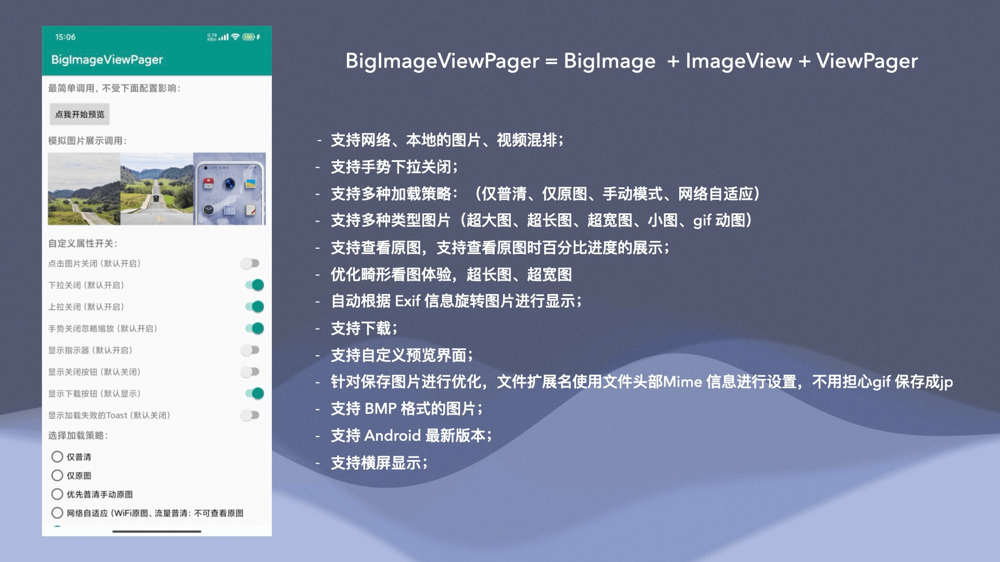
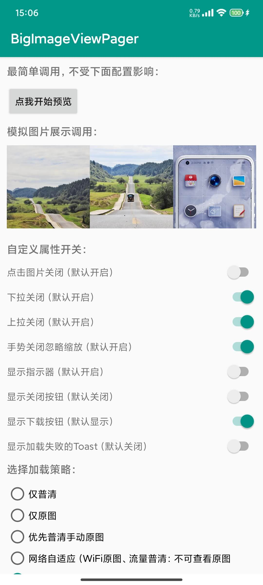
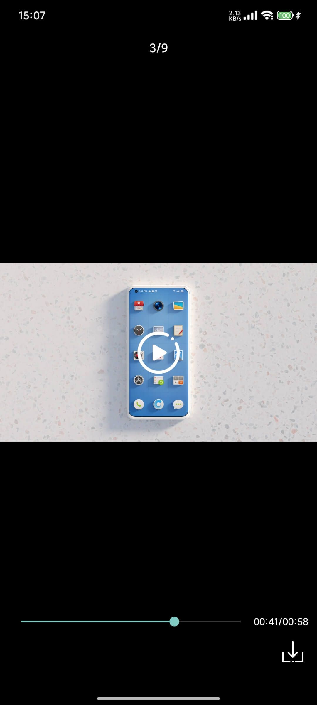
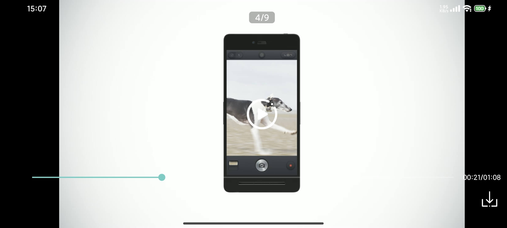
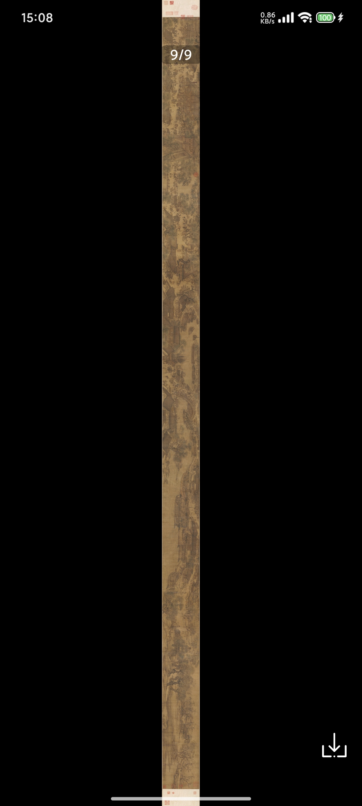

<p style="text-align: center;">
  
</p>

# BigImageViewPager

📷 一个支持 **超大图 / 超长图 / GIF / 视频** 的轻量级预览库

[](https://maven.org/)
[](https://github.com/SherlockGougou/BigImageViewPager/stargazers)
[](https://github.com/SherlockGougou/BigImageViewPager/blob/master/LICENSE)

---

## 目录

- [特性](#特性)
- [安装](#安装)
- [快速开始](#快速开始)
- [模块拆分与迁移](#模块拆分与迁移)
- [运行时行为](#运行时行为)
- [更新日志](#更新日志)
- [界面与视频展示](#界面与视频展示)
- [社区与支持](#社区与支持)
- [License](#license)

---

## 特性

- 支持 **超大图 / 超长图 / GIF / 视频**
- 支持 **双指缩放 / 平移 / 左右滑动切换**
- 支持 **原图查看 / 下载 / 加载进度监听**
- 支持 **视频播放策略**：WiFi 自动播放 / 始终自动播放 / 手动播放
- 支持 **数据源动态更新与删除**
- 采用 **区块复用加载**，有效降低内存占用并减少 OOM 风险

---

## 安装

> 当前版本：`androidx-9.2.3`

### 1) 添加仓库

在你的项目仓库配置中确保包含 `mavenCentral()`。

### 2) 添加依赖

`BigImageViewPager` 已拆分为核心库与可选视频插件：

- 核心库（必选）：`com.gouqinglin:BigImageViewPager`
- 视频插件（可选）：`com.gouqinglin:BigImageViewPager-media3`

```gradle
dependencies {
    // 必选：核心库（图片能力）
    implementation "com.gouqinglin:BigImageViewPager:androidx-9.2.3"

    // 可选：视频插件（需要视频预览时添加）
    implementation "com.gouqinglin:BigImageViewPager-media3:androidx-9.2.3"

    // 必选：Glide
    def glideVersion = "4.16.0"
    implementation "com.github.bumptech.glide:glide:$glideVersion"
    annotationProcessor "com.github.bumptech.glide:compiler:$glideVersion"
    implementation "com.github.bumptech.glide:okhttp3-integration:$glideVersion"
}
```

源码方式接入（本仓库本地调试）：

```gradle
// implementation(project(":library"))
// implementation(project(":library-video-media3"))
```

---

## 快速开始

### 1) 配置 GlideModule

```
@GlideModule
public class MyAppGlideModule extends AppGlideModule {
    @Override
    public void registerComponents(@NonNull Context context, @NonNull Glide glide, @NonNull Registry registry) {
        super.registerComponents(context, glide, registry);
        registry.replace(
                GlideUrl.class,
                InputStream.class,
                new OkHttpUrlLoader.Factory(ProgressManager.getOkHttpClient())
        );
    }
}
```

> 注意：如果不配置，原图加载进度可能长期停在 1%。

### 2) 发起预览

```
ImagePreview.getInstance().setContext(MainActivity.this).setMediaInfoList(imageInfoList).start();
```

更多参数配置见：[`doc/DETAIL.md`](doc/DETAIL.md)

### 3) 视频播放策略（可选）

```
// 设置视频仅在 WiFi 下自动播放
ImagePreview.getInstance()
    .setContext(MainActivity.this)
    .setMediaInfoList(imageInfoList)
    .setVideoPlayPolicy(ImagePreview.VideoPlayPolicy.WiFiOnly)
    .start();
```

三种策略：`WiFiOnly` / `WiFiAndMobile`（默认） / `Manual`

### 4) 鉴权图片的稳定缓存键（可选）

URL 中的签名定期变化时，可通过 `setImageCacheKeyProvider` 提供稳定缓存键。
实际请求仍使用完整 URL；不配置时继续按完整 URL 缓存。

```kotlin
ImagePreview.instance
    .with(activity)
    .setImageUrlList(urls)
    .setImageCacheKeyProvider { url -> cacheKeysByUrl[url] }
    .start()
```

`cacheKeysByUrl` 是调用方准备的不可变映射，键为本次完整 URL，值为稳定资源标识。
例如 `accountId:photoId:version:original` 和 `accountId:photoId:version:thumb-200`。
返回 `null` 的 URL 保持默认规则；不要一律删除查询参数，以免混淆规格和内容版本。
完整示例及边界见 [详细用法](doc/DETAIL.md#鉴权图片的稳定缓存键)。

---

## 模块拆分与迁移

`androidx-9.2.0` 起，视频能力从核心库中解耦为可选插件：

- `BigImageViewPager`：核心图片能力
- `BigImageViewPager-media3`：基于 Media3 的视频能力

迁移建议：

- 仅图片预览：保留 `BigImageViewPager` 即可
- 需要视频预览：额外添加 `BigImageViewPager-media3`

发布建议（源码仓库维护者）：

- 核心库 artifactId：`BigImageViewPager`
- 视频插件 artifactId：`BigImageViewPager-media3`
- 两个 artifact 保持相同版本号发布

---

## 运行时行为

- 未引入 `BigImageViewPager-media3`：视频条目自动降级为“视频能力不可用”提示，不影响图片预览。
- 引入 `BigImageViewPager-media3`：视频能力自动启用，无需额外初始化。
- 关闭预览页时会释放视频运行时资源；再次进入会自动重建缓存和播放器会话。

---

## 更新日志

- `androidx-9.2.3`：新增可配置的图片稳定缓存键，支持鉴权链接签名轮换后复用缓存；统一预览、查看原图和保存图片的缓存键，修复文件下载使用 `ALL` 导致失败及重复请求的问题（#231）
- `androidx-9.2.2`：新增视频播放策略 `VideoPlayPolicy`，支持 WiFi 自动播放 / 始终自动播放 / 手动播放
- `androidx-9.2.1`：修复视频 Fragment 回收后只有音频的问题，清理残留 View 引用
- `androidx-9.2.0`：ExoPlayer (Media3) 改为可选依赖，仅图片场景可减少 APK 体积
- `androidx-8.4.7`：支持 32 位 16KB page size 特性
- `androidx-8.4.6`：新增支持 `res` 资源
- `androidx-8.4.5`：新增自定义请求头功能
- `androidx-8.4.4`：修复本地视频加载问题

---

## 界面与视频展示

### 图片展示

<table>
  <tr>
    <td align="center"></td>
    <td align="center"></td>
    <td align="center"></td>
  </tr>
  <tr>
    <td align="center"></td>
    <td align="center"></td>
    <td align="center"></td>
  </tr>
</table>

### 视频展示

<table>
  <tr>
    <td align="center">
      <video controls preload="metadata" width="100%" src="https://github.com/user-attachments/assets/101d706c-d8d0-455b-b38a-6c42282c03e2"></video>
    </td>
    <td align="center">
      <video controls preload="metadata" width="100%" src="https://github.com/user-attachments/assets/b7becb07-e6bd-459b-9795-d048d02fb21b"></video>
    </td>
    <td align="center">
      <video controls preload="metadata" width="100%" src="https://github.com/user-attachments/assets/070caa63-8e9f-4b11-9240-4cb56440d3c2"></video>
    </td>
  </tr>
</table>

### Star 曲线

[](https://star-history.com/#SherlockGougou/BigImageViewPager&Date)

---

## 社区与支持

### 社区交流

<p style="text-align: center;">
  <a title="qq">
    
  </a>
</p>

### 支持项目

<table>
  <tr>
    <td align="center"></td>
    <td align="center"></td>
  </tr>
</table>

### 致谢

- Powered by DartNode - Free VPS for Open Source

<p style="text-align: center;">
  <a href="https://dartnode.com" title="Powered by DartNode - Free VPS for Open Source">
    
  </a>
</p>

---

## License

```text
Copyright (C) 2018 SherlockGougou
Licensed under the Apache License, Version 2.0
http://www.apache.org/licenses/LICENSE-2.0
```

